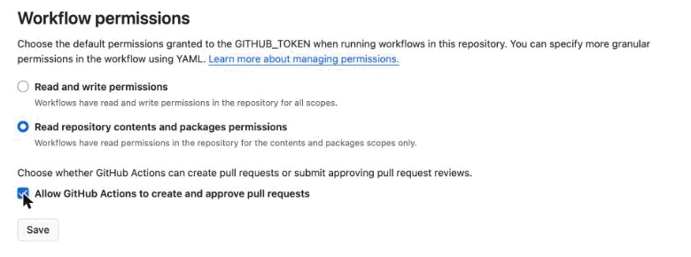
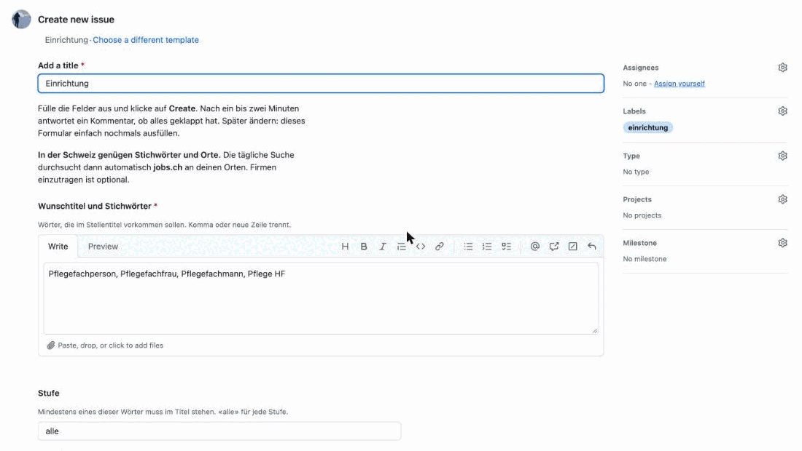
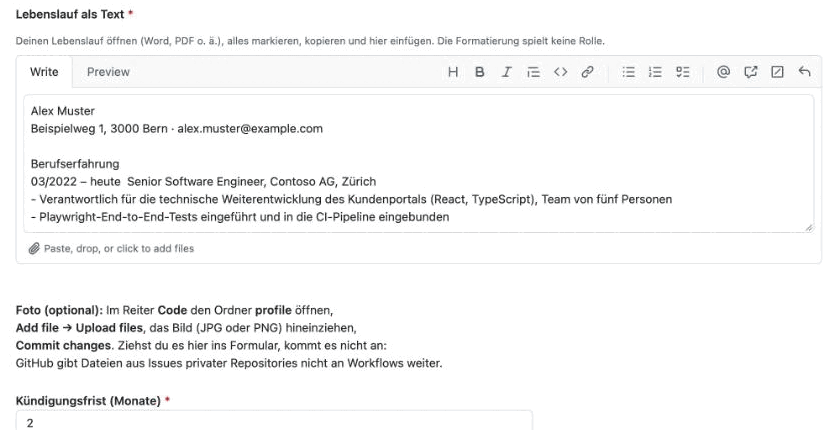
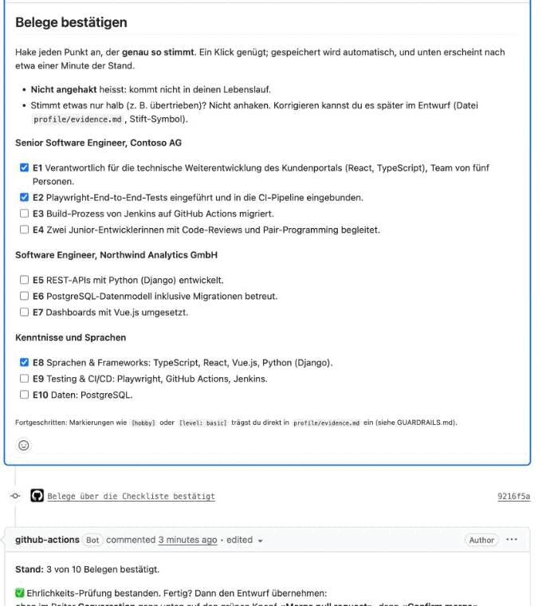
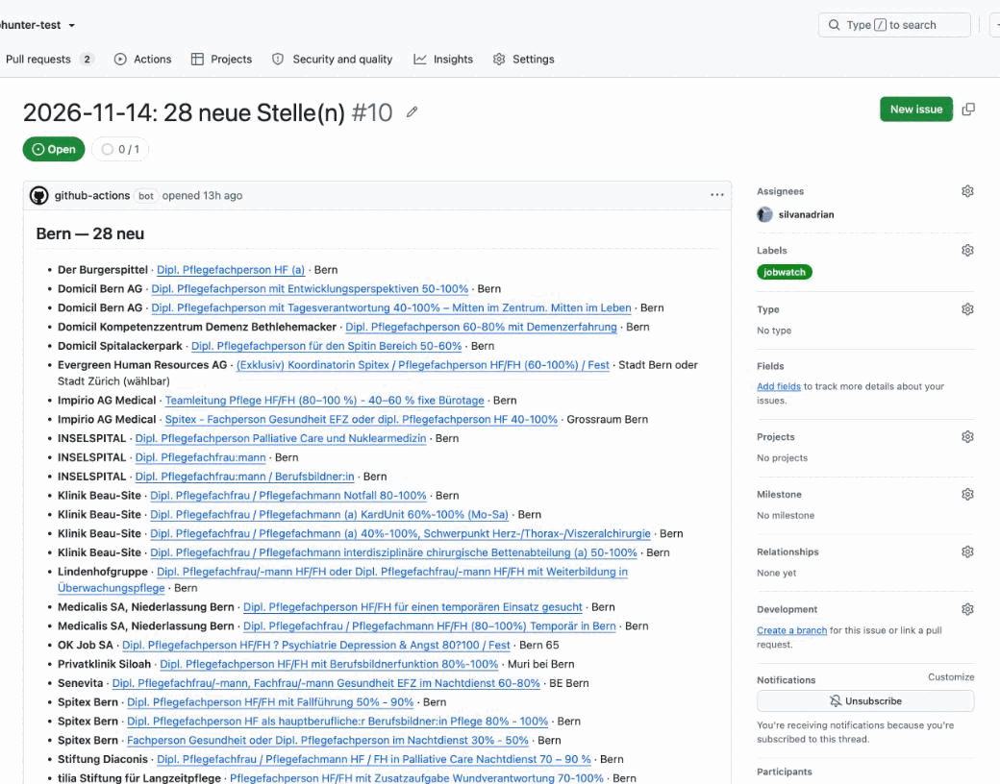
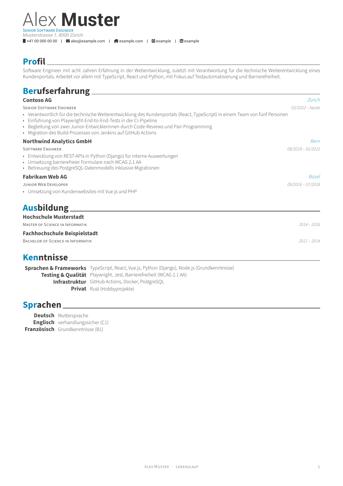
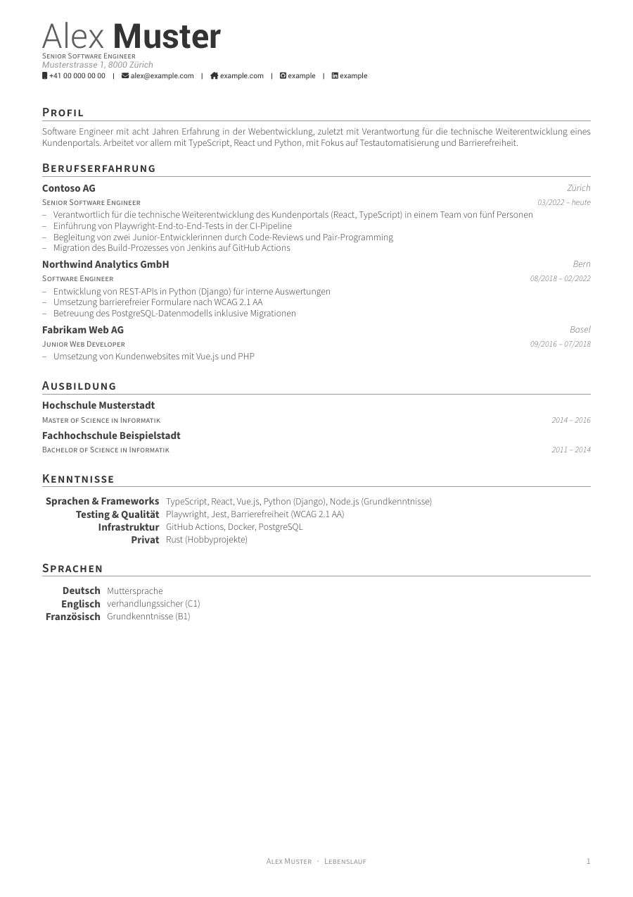
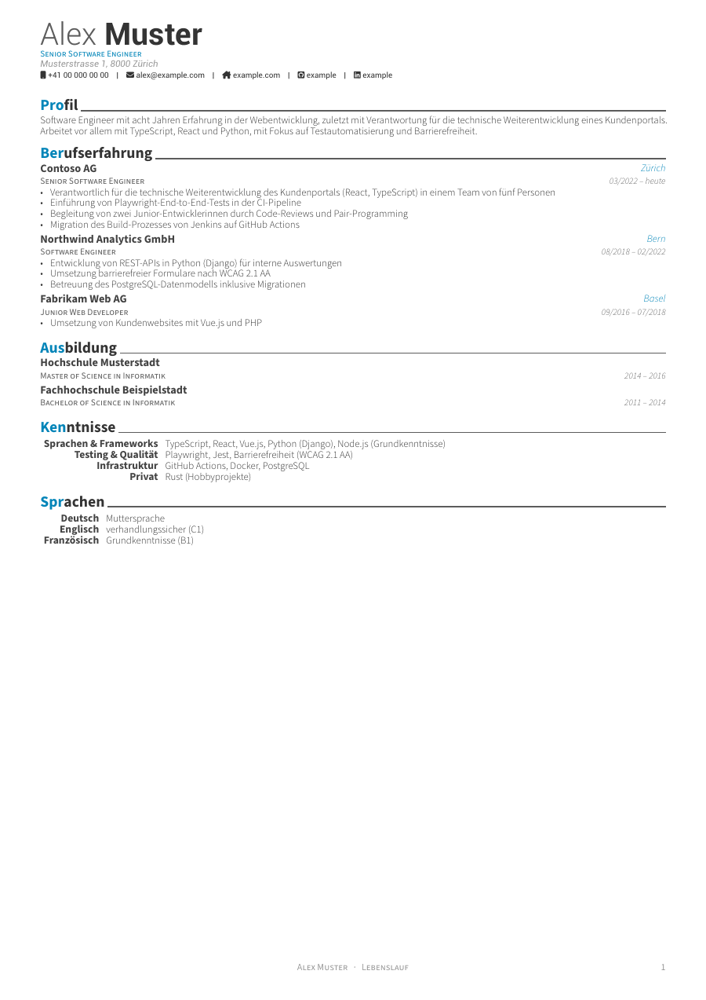

# jobhunter

Dein persönlicher Assistent für die Stellensuche, komplett in GitHub und
standardmässig gratis:

- **Jeden Werktagmorgen** bekommst du die neuen passenden Stellen, in der
  Schweiz direkt von **jobs.ch**, auf Wunsch auch von den Karriereseiten
  deiner Wunschfirmen.
- **Für eine Stelle, die dich interessiert,** entsteht ein Bewerbungspaket:
  angepasster Lebenslauf, Motivationsschreiben, eine ehrliche Einschätzung, wie
  gut du passt, und ein Vorbereitungsblatt fürs Gespräch.
- **Ehrlich:** Jede Aussage muss auf etwas zurückgehen, das du selbst bestätigt
  hast. Lücken werden benannt, nicht versteckt.
- **Einreichen machst immer du.** Das Toolkit füllt nie ein Bewerbungsformular
  aus und legt nie Konten an.

Du brauchst nur ein kostenloses GitHub-Konto und einen Browser. Programmieren
musst du nicht.

---

## So startest du (etwa 15 Minuten)

### 1. Eine eigene, private Kopie anlegen

Oben auf dieser Seite **«Use this template» → «Create a new repository»**.
Gib einen Namen ein (z. B. `stellensuche`) und wähle unbedingt **Private**.

> **Wichtig: privat.** Deine Kopie wird deinen Lebenslauf, deine
> Lohnvorstellung und deine Bewerbungen enthalten. Nicht «Fork» verwenden,
> ein Fork ist öffentlich.

### 2. Eine Einstellung setzen

In deiner Kopie: **Settings → Actions → General**, ganz unten bei «Workflow
permissions» das Häkchen **«Allow GitHub Actions to create and approve pull
requests»** setzen und **Save** klicken.

Fragt GitHub im Reiter **Actions** nach, ob die Workflows laufen dürfen: **«I
understand my workflows, go ahead and enable them»**.

### 3. Sagen, was du suchst

**Issues → New issue → Einrichtung.** Wunschtitel, Orte und «Remote ja/nein»
eintragen, der Rest ist optional. **Create** klicken.

Nach ein bis zwei Minuten bestätigt ein Kommentar die Einrichtung, und die erste
Stellensuche startet sofort. Der Kommentar enthält auch den Link zum nächsten
Schritt.

### 4. Deinen Lebenslauf einfügen

**Issues → New issue → Profil.** Deinen Lebenslauf öffnen (Word, PDF o. ä.),
alles markieren, kopieren und einfügen. Dazu Kündigungsfrist, Lohnvorstellung,
Pensum und den gewünschten [Stil](#der-lebenslauf-stil) wählen, **Create**.

Danach erscheint ein Kommentar mit einem **Textblock zum Kopieren**:

1. Den Block kopieren (Symbol oben rechts im Block).
2. In deinen Chat (claude.ai, ChatGPT o. ä.) in einen **neuen** Chat einfügen
   und abschicken.
3. Die Antwort kopieren und im selben Issue als Kommentar einfügen, mit
   **`/profil`** in der ersten Zeile.

> **Datenschutz:** Kostenlose Chats dürfen Eingaben je nach Anbieter zum
> Training verwenden. Schalte das vorher in den Einstellungen deines Chats aus.

### 5. Bestätigen, was stimmt

Es entsteht ein **Entwurf** deines Profils (auf GitHub heisst das «Pull
Request»). Darin steht eine **Checkliste**: Hake jeden Punkt an, der genau so
stimmt. Nur Angehaktes kommt in deinen Lebenslauf.

Steht darunter **«✅ Ehrlichkeits-Prüfung bestanden»**, ganz unten auf den
grünen Knopf **«Merge pull request»** und dann **«Confirm merge»** klicken.
Fertig eingerichtet.

---

## Im Alltag

**Jeden Werktag früh** erscheint ein Issue mit den neuen Stellen. GitHub
benachrichtigt dich per E-Mail oder in der GitHub-App.

**Für eine Stelle bewerben:**

1. Im Issue bei der Stelle auf **«Bewerbung vorbereiten →»** klicken und im
   Formular **Create**. (⭐ markiert Stellen, die besonders gut passen.)
2. Es erscheint wieder ein **Textblock zum Kopieren**. Wie beim Profil in deinen
   Chat kopieren und die Antwort mit **`/paket`** in der ersten Zeile
   zurückkopieren. (Mit Copilot CLI entfällt das, siehe [Was kostet das?](#was-kostet-das).)
3. Es entsteht ein **Entwurf** mit Lebenslauf und Brief als PDF. Ansehen,
   prüfen und, wenn alles stimmt, mit **«Merge pull request»** übernehmen.
   Ändern kannst du jede Datei direkt im Browser; danach wird automatisch neu
   geprüft.
4. Danach erscheint ein Issue mit den fertigen PDFs und einer Anleitung.
   **Einreichen machst du** auf der Seite der Firma. Hat die Firma den Eingang
   bestätigt, hakst du im Kommentar **«Stand dieser Bewerbung»** das Kästchen
   **Eingereicht** an. Genauso später jede Runde (**1. Gespräch**, **2.
   Gespräch**, **Weitere Runde** wie Fallstudie oder Assessment), **Angebot
   erhalten**, **Absage erhalten** oder **Zurückgezogen**. Ein Angebot lässt
   das Issue offen, bis du zu- oder absagst.

**Neue Stelle, Kurs oder Kenntnis?** **Issues → New issue → Profil ergänzen**,
beschreiben, **Create**. Daraus entsteht ein Entwurf, der dein Profil nur
ergänzt: neue Punkte anhaken und mit **«Merge pull request»** übernehmen.

Das Toolkit erinnert dich an Bewerbungsfristen, schlägt nach zwei Wochen ohne
Antwort ein Nachfassen vor und fragt jeden Montag nach dem Stand.

---

## Was die Suche findet und was nicht

- **jobs.ch:** in der Schweiz automatisch dabei. Das deckt die meisten
  Arbeitgeber ab, auch grosse mit eigenem Bewerbungsportal.
- **Karriereseiten von Firmen:** nur, wenn die Firma eines dieser
  Bewerbungssysteme nutzt: Greenhouse, Lever, Ashby, Personio, Recruitee,
  SmartRecruiters, Workable, BambooHR, Breezy, Teamtailor oder Workday. Welches
  System eine Firma nutzt, verrät meist der Link einer einzelnen Stelle. Die
  Firma trägst du im Formular «Einrichtung» ein. Firmen mit einem eigenen
  Portal lassen sich nicht direkt beobachten.
- **Nicht dabei:** LinkedIn und Indeed. Beide blockieren automatische Abfragen.
- **Einzelne Inserate gehen immer:** Findest du selbst eine Stelle, egal wo,
  gibst du im Formular «Stelle vorbereiten» den Link an oder fügst den Text
  des Inserats ein.

## Der Lebenslauf-Stil

Drei Stile stehen zur Wahl. Du wählst im Formular «Profil» und kannst später
jederzeit wechseln (Datei `profile/cv.yaml`, Zeile `theme:`).

| klassisch | schlicht | kompakt |
|---|---|---|
|  |  |  |
| blaue Akzente | schwarz-grau, für Banken, Verwaltung, Gesundheitswesen | enger, für lange Lebensläufe |

Mehr dazu, auch zur eigenen Akzentfarbe: [docs/stile/](docs/stile/README.md).

---

## Kurz erklärt: die GitHub-Wörter

| Auf GitHub | Heisst hier |
|---|---|
| **Repository** | deine private Kopie mit allen Daten |
| **Issue** | eine Nachricht oder Aufgabe, z. B. «28 neue Stellen» |
| **Pull Request** | ein **Entwurf**, den du prüfst, bevor er gilt |
| **Merge pull request** | den Entwurf **übernehmen** |
| **Actions** | die Abläufe, die automatisch im Hintergrund laufen |

---

## Was kostet das?

Nichts, solange du **Kopieren & Einfügen** mit einem kostenlosen Chat nutzt.
GitHub Free enthält für private Repositories ein monatliches Kontingent an
Laufzeit für die Abläufe; die tägliche Suche braucht davon wenige Minuten.

Wer nicht kopieren will, lässt die Entwürfe direkt von der GitHub Copilot CLI
schreiben: gratis mit **Copilot Free** (200 Anfragen pro Monat, ein
Bewerbungspaket braucht etwa eine), ohne zusätzliche Einrichtung. Dafür im
Formular «Einrichtung» den Assistenten **copilot-cli** wählen und Copilot Free
unter <https://github.com/settings/copilot> einschalten. Das und alle anderen
Optionen stehen unter [Für Fortgeschrittene](docs/FORTGESCHRITTEN.md#was-kostet-das).

---

## Deine Daten

- Alles liegt in **deiner privaten Kopie**. Ausweise, AHV-Nummern,
  Bankangaben und Arbeitszeugnisse kommen nie hinein.
- An deinen Chat geht nur, was du selbst hineinkopierst.
- Löschen: Settings → ganz unten **Delete this repository**.

Ausführlich: [Datenschutz](docs/FORTGESCHRITTEN.md#datenschutz-was-wo-liegt) und
[Meine Daten löschen](docs/FORTGESCHRITTEN.md#meine-daten-löschen).

---

## Hilfe und mehr

- **Etwas klappt nicht?** Ein Kommentar im betroffenen Issue sagt meist, was
  fehlt. Das angeheftete Issue **«Status»** zeigt, ob die Stellenquellen
  erreichbar sind.
- **Alle Befehle, Optionen und Hintergründe:** [Für Fortgeschrittene](docs/FORTGESCHRITTEN.md)
  (Befehle in Issues, Copilot CLI, Benachrichtigungen, Board, lokal arbeiten).
- **Neue Versionen der Vorlage:** Einmal im Monat prüft deine Kopie, ob die
  Vorlage verbessert wurde, und eröffnet dann einen Entwurf «Neue Version der
  Vorlage». Deine persönlichen Daten (`jobhunter.yml`, `profile/`, deine
  Bewerbungen) werden dabei nie angefasst. Übernehmen mit «Merge pull request»,
  sonst einfach schliessen ([Einzelheiten](docs/FORTGESCHRITTEN.md#updates-der-vorlage)).
- **Die Regeln für Ehrlichkeit:** [GUARDRAILS.md](GUARDRAILS.md).

---

## Lizenz

- Code, Workflows, Vorlagen und Texte: [MIT](LICENSE).
- Schriften in `fonts/`: Roboto unter Apache License 2.0
  ([LICENSE-Roboto.txt](fonts/LICENSE-Roboto.txt)), Source Sans 3 unter SIL Open
  Font License 1.1 ([LICENSE-SourceSans3.txt](fonts/LICENSE-SourceSans3.txt)),
  Symbole aus Font Awesome Free 6 unter SIL Open Font License 1.1
  ([LICENSE-FontAwesome.txt](fonts/LICENSE-FontAwesome.txt)).
- Die Lebenslauf-Vorlage ist eine eigene Typst-Umsetzung im Stil von
  [Awesome CV](https://github.com/posquit0/Awesome-CV); sie enthält keinen Code
  daraus.
- Die Beispielperson «Alex Muster» und alle Beispielfirmen sind frei erfunden.
