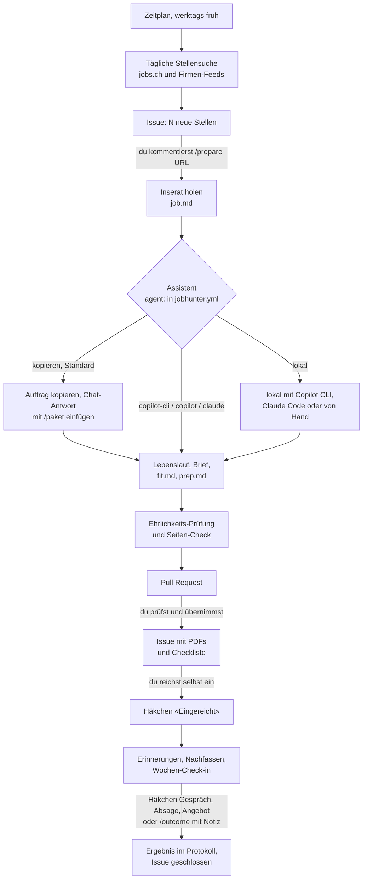

# Für Fortgeschrittene

Alles, was du für den Alltag **nicht** brauchst: Hintergründe, Optionen und
Technik. Der Einstieg steht im [README](../README.md).

- [So läuft es im Alltag](#so-läuft-es-im-alltag)
- [Stand einer Bewerbung per Häkchen](#stand-einer-bewerbung-per-häkchen)
- [Profil ergänzen](#profil-ergänzen)
- [Befehle in Issues](#befehle-in-issues)
- [Was kostet das?](#was-kostet-das)
- [Copilot CLI (optional)](#copilot-cli-optional)
- [Benachrichtigungen aufs Handy (GitHub-App)](#benachrichtigungen-aufs-handy-github-app)
- [Datenschutz: was wo liegt](#datenschutz-was-wo-liegt)
- [Meine Daten löschen](#meine-daten-löschen)
- [Optional: Projects-Board](#optional-projects-board)
- [Lokal, Vorlage und Workflows](#lokal-vorlage-und-workflows)

---

## So läuft es im Alltag



1. **Stellen finden:** Das tägliche Issue listet neue Stellen. Bei Firmen, bei denen du dich schon beworben hast, steht ein
   Hinweis.
2. **Auswählen:** Kommentiere im Issue `/prepare https://…` (oder nutze das
   Formular «Stelle vorbereiten»). Klappt der Link nicht (z. B. LinkedIn), füge
   den Inseratstext unter `/prepare` ein.
3. **Prüfen:** Es entsteht ein Entwurf (Pull Request) mit Lebenslauf-Variante,
   Motivationsschreiben, `fit.md` (Anforderung für Anforderung, mit Lücken) und
   `prep.md` (Vorbereitung fürs Gespräch). Findet die Ehrlichkeits-Prüfung ein
   Problem, heisst der Entwurf «Prüfung fehlgeschlagen …» und listet die Funde
   auf. Die PDFs liegen im Artefakt des Laufs, verlinkt im Entwurf. Ändern kannst
   du alles direkt im Browser; danach wird automatisch neu geprüft und das
   Ergebnis als Kommentar gemeldet.
4. **Übernehmen** («Merge pull request»): Danach erscheint ein Issue mit den fertigen PDFs zum
   Herunterladen, einer Checkliste «So reichst du ein» und darunter einem
   Kommentar «Stand dieser Bewerbung».
5. **Einreichen:** machst du auf der Seite der Firma. Erst wenn eine
   Bestätigung kommt: im Kommentar «Stand dieser Bewerbung» **Eingereicht**
   anhaken (oder `/outcome submitted` kommentieren).
6. **Dranbleiben:** Zwei Tage vor einer Bewerbungsfrist und nach 14 Tagen ohne
   Antwort (mit Vorschlag für eine kurze Nachfrage) meldet sich das Toolkit.
   Jeden Montag fragt ein **Wochen-Check-in** nach dem Stand jeder offenen
   Bewerbung.

---

## Stand einer Bewerbung per Häkchen

Im Issue jeder Bewerbung steht ein Kommentar **«Stand dieser Bewerbung»** mit
Kästchen für Eingereicht, 1. Gespräch, 2. Gespräch, Weitere Runde (z. B.
Fallstudie, Assessment, Probetag), Angebot erhalten, Absage erhalten und
Zurückgezogen / doch nicht beworben. Die Gesprächsrunden landen als `interview`
mit der Runde als Notiz im Protokoll; für noch mehr Runden
`/outcome interview 4. Gespräch` kommentieren. Ein Häkchen wirkt wie der
passende Befehl (`/outcome submitted`, `interview`, `offer`, `declined`,
`withdrawn`): Eintrag im `## Outcome log`, `status:` (und `submitted_at:`) im
Front Matter, Karte auf dem Board verschieben, bei Absage und Zurückgezogen das
Issue schliessen. Ein Angebot lässt das Issue offen; wer annimmt, kommentiert
`/outcome accepted`.

- **Nur einmal:** Was schon im Protokoll steht (auch per Befehl), wird nicht
  doppelt eingetragen. Der Status geht nie zurück (z. B. «Eingereicht»
  nachträglich anhaken, wenn «Gespräch» schon festgehalten ist).
- **Wegnehmen ändert nichts:** Das Protokoll ist eine Historie. Ein
  Versehen korrigierst du in `application.md` von Hand.
- «Zurückgezogen» wird zu `withdrawn`, wenn eingereicht war, sonst zu
  `skipped` («nicht beworben»).
- Nur Häkchen der Besitzerin oder des Besitzers zählen. Nach jedem Häkchen
  kurz warten: Sehr schnelle Klicks hintereinander übernimmt GitHub manchmal
  nicht.
- Nach einem `/outcome`-Befehl wird die Checkliste nachgeführt. Ältere, noch
  offene Bewerbungs-Issues bekommen sie beim nächsten Lauf von «Bewerbung als
  Issue» (Actions → «Bewerbung als Issue» → «Run workflow»), nie doppelt.
- Für Notizen und Gründe bleiben die Befehle: `/outcome declined gap: …`.

---

## Profil ergänzen

Neue Stelle, Kurs, Projekt oder Kenntnis: **Issues → New issue → Profil
ergänzen**, im Feld «Was ist neu?» in eigenen Worten beschreiben, optional die
Quelle (Arbeitszeugnis, Zertifikat …), **Create**. Wie beim Profil überträgt
der Assistent den Text in ein festes Format: bei `agent: kopieren` per Auftrag
zum Kopieren, die Antwort kommt mit `/ergaenzen` in der ersten Zeile zurück;
bei `agent: copilot-cli` direkt im Runner (die CLI darf nur die Antwortdatei
`ergaenzung.yaml` schreiben).

Die Einträge schreibt danach das Programm selbst, **nur ergänzend**:

- neue Belege `E<n>`, fortlaufend und nie wiederverwendet (auch keine IDs, die
  früher gelöscht wurden oder ein anderer offener Entwurf nutzt), alle
  `[unbestätigt]`;
- eine neue Stelle als `## R<n> | …` in `profile/evidence.md` und oben unter
  `experience:` in `profile/cv.yaml`; neue Tätigkeiten zu einer bisherigen
  Stelle als neue Punkte mit `evidence:`; Kenntnisse als neue Zeile unter
  `skills:` (gibt es die Gruppe schon, mit «(ergänzt)»); Kurse oben unter
  `education:` mit `evidence:` (die Ehrlichkeits-Prüfung prüft solche Einträge
  wie Punkte).
- Bestehende Belege, Stellen, Punkte und Kenntnisse bleiben unverändert. Das
  prüft der Code gegen `main` (`python -m jobwatch.ergaenzen pruefen`); sonst
  entsteht kein Entwurf, sondern ein Fehler-Kommentar.

Es entsteht ein Entwurf (Zweig `ergaenzen/issue-<n>`) mit der Checkliste
«Belege bestätigen», aber nur mit den neuen Belegen. Häkchen wirken wie beim
Profil (`belege.yml`); `profile/cv.yaml` wird dabei nur für die neuen Einträge
angeglichen.

---

## Befehle in Issues

Nur du (Besitzer:in des Repositorys) kannst diese Befehle auslösen. Den Stand
einer Bewerbung hältst du einfacher per [Häkchen](#stand-einer-bewerbung-per-häkchen)
fest; die `/outcome`-Befehle braucht es für Notizen und Gründe.

| Befehl | Wo | Wirkung |
|---|---|---|
| `/prepare <URL>` | tägliches Issue oder beliebiges Issue | Bewerbungspaket vorbereiten |
| `/paket` + Antwort des Chats | Issue «Vorbereiten: …» | Antwort übernehmen, Ehrlichkeits-Prüfung, PDFs, Entwurf (agent: kopieren) |
| `/profil` + Antwort des Chats | Issue «Profil» | Profil-Entwurf als Pull Request (agent: kopieren) |
| `/ergaenzen` + Antwort des Chats | Issue «Profil ergänzen» | Ergänzung als Entwurf, nur neue Einträge (agent: kopieren) |
| `/outcome submitted` | Issue einer Bewerbung | als eingereicht festhalten (nur nach Bestätigung der Firma!); einfacher: Häkchen «Eingereicht» |
| `/outcome interview Gespräch am 3.12.` | Issue einer Bewerbung | Gespräch festhalten |
| `/outcome declined gap: Führungserfahrung` | Issue einer Bewerbung | Absage mit Grund festhalten, Issue schliessen |
| `/outcome accepted` | Issue einer Bewerbung | Angebot angenommen, Issue schliessen |
| `/status <slug> interview\|absage\|angebot\|keine-antwort\|zurückgezogen [Notiz]` | Wochen-Check-in | Stand einer Bewerbung festhalten |
| `/aufraeumen` | Aufbewahrungs-Issue | alte Bewerbungen archivieren/löschen (nur wenn eingeschaltet) |

Häufen sich Absagen mit derselben Lücke (`gap: …`), schlägt der Wochen-Check-in
gezielte Vorbereitung vor — nie eine Formulierung, die die Lücke versteckt.

---

## Was kostet das?

| | Was | Kosten |
|---|---|---|
| **Grundbetrieb** | GitHub Actions (Stellensuche, Erinnerungen, Build) | In **privaten** Repositories enthält GitHub Free ein monatliches Kontingent an Actions-Minuten; öffentliche Repositories sind gratis. Ein Tag mit Stellensuche braucht wenige Minuten. Details: [GitHub-Abrechnung für Actions](https://docs.github.com/en/billing/managing-billing-for-your-products/managing-billing-for-github-actions/about-billing-for-github-actions) |
| | Typst (PDF-Erzeugung), Schriften | gratis, Open Source |
| **Standard** | `agent: kopieren` — Kopieren & Einfügen: Auftrag in deinen Chat (claude.ai, ChatGPT o. ä.), Antwort mit `/paket` zurück | **gratis**, zweimal kopieren pro Paket. Gratis-Stufen der Chats genügen meist; Datenschutz-Einstellungen des Anbieters prüfen. |
| **Upgrade** | `agent: copilot-cli` — GitHub Copilot CLI schreibt im Actions-Runner Lebenslauf-Variante, Brief, `fit.md`, `prep.md` und den Profil-Entwurf | **gratis mit Copilot Free**, 200 Chat-Anfragen pro Monat, ein Paket braucht etwa eine (mit Copilot Free getestet). Eingebautes Token genügt ([Details](#copilot-cli-optional)). |
| **Upgrade** | `agent: copilot` — Copilot-Coding-Agent bearbeitet das Unter-Issue und eröffnet den PR | **ab Copilot Pro** (nicht in Copilot Free), dazu Secret `COPILOT_ASSIGN_TOKEN`. [Copilot-Pläne](https://github.com/features/copilot/plans) |
| **Upgrade** | `agent: claude` — Claude Code Action | Secret `ANTHROPIC_API_KEY`, Abrechnung nach Nutzung bei Anthropic über die API |
| **Lokal** | `agent: none` (im Formular «lokal») — nur das Inserat wird geholt; du arbeitest auf deinem Rechner weiter (Copilot CLI, Claude Code oder von Hand) | nichts zusätzlich |
| optional | E-Mail über Resend | eigenes Konto bei diesem Dienst, mit Gratis-Stufe |

Pläne und Kontingente von Copilot: <https://github.com/features/copilot/plans>.
Die Leitplanken und die Ehrlichkeits-Prüfung gelten für alle Wege gleich.

> Bis Juli 2026 war GitHub Models der Gratisweg (`agent: models`). GitHub hat
> GitHub Models am 30.07.2026 eingestellt; eine alte Einstellung
> `agent: models` meldet jetzt einen Fehler mit dem Hinweis auf `kopieren` und
> `copilot-cli`.
> Die tägliche Stellensuche läuft davon unabhängig weiter.

**Halte dein Repository privat** — auch wenn öffentliche Repositories mehr
Gratis-Minuten haben. Es enthält persönliche Daten.

---

## Copilot CLI (optional)

Mit `agent: copilot-cli` schreibt die GitHub Copilot CLI die Entwürfe direkt in
GitHub Actions, ohne Kopieren. Voraussetzung ist ein Copilot-Plan auf deinem
Konto; **Copilot Free** enthält die Copilot CLI (unter
<https://github.com/settings/copilot> aktivieren). Das Kontingent von Copilot
Free umfasst 200 Chat-Anfragen pro Monat (Stand November 2026, sichtbar unter
<https://github.com/settings/copilot>). Im Test mit Copilot Free brauchte ein
Profil-Entwurf eine Anfrage und ein Bewerbungspaket ebenfalls eine; das reicht
für weit über hundert Pakete im Monat. Getestet am 15.11.2026 mit dem
eingebauten Token, ohne Secret.

Normalerweise braucht es **kein Secret**: Seit Juli 2026 nimmt die Copilot CLI
in Actions das eingebaute Token des Workflows (Berechtigung
`copilot-requests: write`, in den Workflows schon gesetzt); die Nutzung zählt
auf deinen Copilot-Plan. Scheitert ein Lauf, erklärt ein Kommentar den Grund
(z. B. Kontingent aufgebraucht, Copilot-Plan fehlt, Richtlinie sperrt die CLI)
und liefert gleich den Auftrag zum Kopieren & Einfügen mit.

**Nur falls GitHub das eingebaute Token ablehnt** («Authentication failed»):
ein Fine-grained Token als Secret `COPILOT_GITHUB_TOKEN` hinterlegen.

1. <https://github.com/settings/personal-access-tokens/new> öffnen (Profilbild →
   **Settings → Developer settings → Personal access tokens → Fine-grained
   tokens → Generate new token**).
2. **Token name** z. B. `jobhunter Copilot CLI`, **Expiration** z. B. 90 Tage.
3. **Resource owner:** dein **persönliches Konto**, keine Organisation. Nur dann
   erscheint die Berechtigung «Copilot Requests».
4. **Repository access:** «Public repositories». Tipp: Bei anderer Auswahl fehlt
   «Copilot Requests» manchmal in der Liste.
5. **Permissions → Reiter «Account» → Add permissions → «Copilot Requests»**.
   Sonst nichts.
6. **Generate token** und das Token kopieren (beginnt mit `github_pat_`).
   Klassische Tokens (`ghp_…`) lehnt Copilot ab.
7. Im Repository: **Settings → Secrets and variables → Actions → New
   repository secret**, Name **`COPILOT_GITHUB_TOKEN`**, Wert einfügen, **Add
   secret**.

Ist das Secret gesetzt, nimmt der Workflow es statt des eingebauten Tokens.
Läuft es ab, ein neues erstellen und das Secret ersetzen.

---

## Benachrichtigungen aufs Handy (GitHub-App)

1. GitHub-App für iOS oder Android installieren und anmelden.
2. In der App: **Profil → Einstellungen → Benachrichtigungen** — Push für
   «Zugewiesen» und «Erwähnungen» einschalten.
3. Die täglichen Issues und die Bewerbungs-Issues sind dir zugewiesen, du
   bekommst also eine Push-Nachricht.

Lieber E-Mail? Unter <https://github.com/settings/notifications> «Email» bei
«Participating, @mentions and custom» einschalten. Für eine schön formatierte
eigene E-Mail: Konto bei [Resend](https://resend.com), Secret
`RESEND_API_KEY` und Variable `JOBWATCH_EMAIL_TO` (Settings → Secrets and
variables → Actions) setzen.

---

## Datenschutz: was wo liegt

- **Im privaten Repository:** `jobhunter.yml` (Suche, Ausschlussliste,
  Kündigungsfrist, Lohnvorstellung), `profile/` (Belege, Lebenslauf-Daten,
  **Foto** als `profile/foto.jpg` — in der Schweiz üblich), `applications/`
  (Inserate, Entwürfe, Protokolle), `.jobwatch/seen.json` (gesehene Stellen).
  Deshalb muss das Repository **privat** bleiben.
- **Nie im Repository** (durch `.gitignore` ausgeschlossen): Arbeitszeugnisse
  und Diplome (`profile/dokumente/`, ausser du schaltest
  `documents.store_certificates` bewusst ein), Ausweis- und Passkopien,
  AHV-Nummern, Bankangaben, Lohnausweise. Diese Dokumente nur lokal oder direkt
  beim Arbeitgeber hochladen.
- **Was an deinen Chat geht** (mit `agent: kopieren`): nur was du selbst
  kopierst — das Inserat, deine **bestätigten** Belege, die Punkte deines
  Basis-Lebenslaufs und die Regeln; beim Profil der Text deines Lebenslaufs;
  beim Ergänzen dein Text aus dem Formular und die Liste deiner Stellen.
  Kostenlose Chat-Angebote dürfen Eingaben je nach Anbieter und Einstellung zum
  Training verwenden: vorher in den Datenschutz-Einstellungen des Anbieters
  prüfen und das Training ausschalten.
- **Was an GitHub Copilot geht** (mit `agent: copilot-cli` und `copilot`): Die Copilot CLI läuft im Actions-Runner und liest
  dort Dateien deines Repositorys, um den Entwurf zu schreiben: das Inserat,
  `profile/evidence.md` (auch unbestätigte Einträge sind lesbar, dürfen aber
  nicht zitiert werden), `profile/cv.yaml` mit deinen Kontaktdaten,
  `profile/target.md` und beim Profil-Entwurf den Text deines hochgeladenen
  Lebenslaufs. Diese Inhalte gehen an **GitHub Copilot** und die dort
  verwendeten Modelle, nur wenn du `/prepare` auslöst oder das Formular
  «Profil» bzw. «Profil ergänzen» ausfüllst. Die CLI darf nur die Paketdateien schreiben, keine
  Befehle ausführen und keine Webseiten abrufen. Wie GitHub diese Daten
  behandelt, steht in den Datenschutzbestimmungen und Copilot-Einstellungen
  deines Kontos (<https://github.com/settings/copilot>). Mit `agent: claude`
  gehen dieselben Inhalte an Anthropic. Wer das nicht will: `agent: none`
  («lokal»).
- **Inserate abrufen:** `fetch-ad` lädt genau die eine Seite, die du angibst,
  einmal. Es ist kein Scraper (kein Crawling, keine Paginierung). Halte dich an
  die Nutzungsbedingungen der jeweiligen Seite. Manche Seiten (z. B. LinkedIn)
  blockieren automatische Abrufe — dann den Text einfügen.
- Die tägliche Suche nutzt öffentliche Stellen-Schnittstellen der
  Bewerbungssysteme (Greenhouse, Lever, Ashby, Personio …) und die Suche von
  Jobbörsen. Diese können sich ohne Ankündigung ändern.

---

## Meine Daten löschen

- **Einzelne Bewerbung:** Ordner `applications/<slug>/` löschen (im Browser:
  Datei öffnen → «…» → Delete file) und das zugehörige Release unter
  **Releases** löschen.
- **Automatisch aufräumen:** in `jobhunter.yml` `retention: {enabled: true,
  months: 12, mode: archive}` (oder `delete`). Monatlich erscheint ein Issue mit
  den betroffenen Bewerbungen; erst dein Kommentar `/aufraeumen` führt es aus.
- **Alles:** Settings → ganz unten **Delete this repository**. Die Daten liegen
  sonst nirgends (ausser in Benachrichtigungs-E-Mails, die du selbst löschst).
- Hinweis: Gelöschte Dateien bleiben in der Git-Historie des Repositorys, bis
  du das ganze Repository löschst.

---

## Optional: Projects-Board

Ein Board mit den Spalten **Gefunden → Vorbereitet → Eingereicht → Interview →
Absage / Angebot**, das sich selbst nachführt.

1. Dein Profil → **Projects → New project → Board**. Im Feld «Status» genau
   diese Optionen anlegen: Gefunden, Vorbereitet, Eingereicht, Interview,
   Absage, Angebot.
2. Das eingebaute Token der Workflows hat **keinen Zugriff** auf Boards, die
   einem Benutzerkonto gehören. Darum: ein klassisches Personal Access Token
   mit den Scopes `project` und `repo` erstellen
   (<https://github.com/settings/tokens>) und als Secret `PROJECT_TOKEN`
   speichern.
3. In `jobhunter.yml`: `board: {enabled: true, owner: <dein-benutzername>,
   number: <nummer aus der Board-URL>}`.

Ohne diese Schritte läuft alles andere normal; das Board ist rein optional.

---

## Lokal, Vorlage und Workflows

### Lokal oder im Codespace

Ein Codespace (Code → Codespaces → Create) bringt Python, Typst und alle
Werkzeuge mit (`.devcontainer/`). Lokal brauchst du Python 3.11+ und
[Typst 0.13.1](https://github.com/typst/typst/releases/tag/v0.13.1):

```bash
pip install -r requirements.txt          # einzige Abhängigkeit: PyYAML
python -m jobwatch init                  # 6 Fragen → jobhunter.yml
python -m jobwatch check                 # Konfiguration prüfen, jeden Feed anpingen
python -m jobwatch --no-save             # suchen, ohne etwas zu speichern
python -m jobwatch add-company https://boards.greenhouse.io/beispiel
python -m jobwatch fetch-ad https://...  # ein Inserat als applications/<slug>/job.md
python -m jobwatch.prepare prompt applications/<slug> > /tmp/auftrag.md   # Auftrag für den Assistenten
copilot -p "$(cat /tmp/auftrag.md)" -s --allow-tool='write'               # oder Claude Code, oder von Hand
python -m jobwatch.prepare finish applications/<slug>   # Fakten aus dem Profil ergänzen, Guard
python -m jobwatch.guard applications/<slug>     # Belege prüfen
make cv VARIANT=applications/<slug>      # Lebenslauf + Brief als PDF, Seitenzahl prüfen
make test                                # Tests
```

Die Copilot CLI lokal installieren: `npm install -g @github/copilot` (Node.js 22
oder neuer), dann `copilot` starten und mit `/login` anmelden. Anleitung:
[Copilot CLI installieren](https://docs.github.com/en/copilot/how-tos/copilot-cli/set-up-copilot-cli/install-copilot-cli).

Alle Einstellungen mit Erklärung: [`jobhunter.example.yml`](../jobhunter.example.yml).

### Mit Claude Code oder GitHub Copilot lokal

Die Anleitungen für Assistenten liegen als **Agent Skills** in
[`.github/skills/`](../.github/skills/) (für Claude Code zusätzlich unter
`.claude/skills/` verlinkt): `triage-jobwatch`, `tailor-application`,
`prepare-interview`, `record-application`, `record-outcome`. Konventionen:
[AGENTS.md](../AGENTS.md). Leitplanken: [GUARDRAILS.md](../GUARDRAILS.md).

### Lebenslauf-Vorlage

Typst statt LaTeX: [`cv/cv.typ`](../cv/cv.typ) und [`cv/letter.typ`](../cv/letter.typ)
lesen die Daten aus `profile/cv.yaml` und optional einer Variante
`applications/<slug>/cv.yaml`. Gestaltung angelehnt an Awesome CV. Schriften: Roboto
(Apache 2.0) und Source Sans 3 (SIL OFL 1.1), siehe [`fonts/`](../fonts/).

### Workflows im Überblick

| Datei | Auslöser | Zweck |
|---|---|---|
| `jobwatch.yml` | werktags, manuell | Stellensuche → Issue |
| `prepare.yml` | `/prepare`, Label `prepare` | Inserat holen; Auftrag zum Kopieren oder Paket mit der Copilot CLI, Ehrlichkeits-Prüfung, Entwurf |
| `paket.yml` | `/paket`, `/profil` | Antwort des Chats prüfen und übernehmen, Ehrlichkeits-Prüfung, PDFs, Entwurf |
| `build.yml` | jeder Push (auch deine Änderungen in einem Entwurf) | Tests, Ehrlichkeits-Prüfung, PDFs, Seiten-Check, Ergebnis als Kommentar im Entwurf |
| `belege.yml` | Häkchen in der Checkliste «Belege bestätigen» (Profil und Ergänzung) | Belege bestätigen, Lebenslauf angleichen, Stand melden |
| `application-issue.yml` | Merge einer Bewerbung, manuell | Issue mit PDFs (Release-Assets) und Kommentar «Stand dieser Bewerbung» |
| `stand.yml` | Häkchen im Kommentar «Stand dieser Bewerbung» | Protokoll, Board, Issue schliessen (wie `/outcome`) |
| `commands.yml` | `/status`, `/outcome`, `/aufraeumen` | Protokoll, Issues schliessen, Board, Checkliste nachführen |
| `erinnerungen.yml` | täglich | Fristen, Nachfassen, Wochen-Check-in, Aufbewahrung |
| `einrichtung.yml` | Formular «Einrichtung» | `jobhunter.yml`, Labels, Prüfung |
| `profil.yml` | Formular «Profil» | Profilangaben übernehmen; Auftrag zum Kopieren oder Entwurf mit der Copilot CLI als PR |
| `ergaenzen.yml` | Formular «Profil ergänzen», `/ergaenzen` | neue Einträge (nur ergänzend, geprüft) als Entwurf mit Checkliste; Auftrag zum Kopieren oder Copilot CLI |
| `status.yml` | wöchentlich, nach Einrichtung | angeheftetes Status-Issue |
| `update.yml` | monatlich, manuell | neue Version der Vorlage als Entwurf anbieten ([Updates der Vorlage](#updates-der-vorlage)) |

Berechtigungen sind pro Workflow minimal gesetzt. Secrets sind alle optional:
`COPILOT_GITHUB_TOKEN` (nur falls die Copilot CLI das eingebaute Token
ablehnt), `RESEND_API_KEY`,
`PROJECT_TOKEN`, `COPILOT_ASSIGN_TOKEN`, `ANTHROPIC_API_KEY`,
`JOBHUNTER_UPDATE_TOKEN`.

Die Copilot CLI wird im Workflow über die Composite Action
[`.github/actions/copilot-cli`](../.github/actions/copilot-cli/action.yml) in einer
festen Version installiert (`npm install -g @github/copilot@<version>`) und im
Programmiermodus gestartet: `copilot -p <auftrag> -s --no-ask-user`, Schreibrecht
nur für die Paketdateien, Shell, Web und MCP-Server gesperrt. `--model` wird
nur übergeben, wenn `copilot_cli.model` gesetzt ist (Copilot Free bietet nur
die automatische Modellwahl).

### Updates der Vorlage

Deine Kopie aus «Use this template» ist nicht mit der Vorlage verbunden. Darum
prüft `update.yml` einmal im Monat (oder von Hand: **Actions → Neue Version der
Vorlage → Run workflow**), ob die Vorlage Neues hat, und eröffnet dann einen
Entwurf **«Neue Version der Vorlage»**. Übernehmen mit **«Merge pull
request»**; schliesst du ihn, kommt derselbe Entwurf nicht wieder, erst bei der
nächsten Änderung der Vorlage ein neuer.

- **Was ersetzt wird:** nur Dateien der Vorlage: `.github/`, `.devcontainer/`,
  `.claude/`, `jobwatch/`, `cv/`, `scripts/`, `fonts/`, `docs/`, `tests/`,
  `applications/_*` und einzelne Dateien wie `README.md`, `GUARDRAILS.md`,
  `AGENTS.md`, `Makefile`, `requirements.txt`, `jobhunter.example.yml`,
  `.gitignore`. Eigene Änderungen an diesen Dateien werden überschrieben (der
  Entwurf zeigt jede Datei).
- **Was nie angefasst wird:** `jobhunter.yml`, `profile/`, deine Bewerbungen
  `applications/<slug>/` und `.jobwatch/`. Gelöscht wird nur, was aus der
  Vorlage stammt; Dateien, die du selbst in einen dieser Ordner gelegt hast,
  bleiben.
- **Woher die Vorlage stammt:** aus dem Vermerk «generated from …» deines
  Repositorys. Andere Quelle (z. B. eine eigene Vorlage): Variable
  `JOBHUNTER_UPSTREAM` = `owner/repo` (Settings → Secrets and variables →
  Actions → Variables). Ohne beides endet der Ablauf still.
- **Abläufe (`.github/workflows/`):** Das eingebaute Token darf diese Dateien
  nicht ändern. Darum stehen sie im Entwurf nur als Liste mit Links und einer
  Anleitung zum Kopieren. Damit sie automatisch mitkommen: unter
  <https://github.com/settings/personal-access-tokens/new> ein
  **Fine-grained token** erstellen, nur für dein Repository, Berechtigungen
  **Contents** und **Workflows** auf «Read and write», und als Secret
  `JOBHUNTER_UPDATE_TOKEN` speichern. Das Token läuft ab; danach einfach ein
  neues eintragen.
- Der übernommene Stand steht in `.jobwatch/vorlage.json` (Vorlage, Commit,
  Dateiliste). Logik und Tests: `jobwatch/vorlage.py`, `tests/test_vorlage.py`.

### Diese Vorlage pflegen

Wer dieses Repository als Vorlage anbietet: Settings → **Template repository**
ankreuzen. Nichts im Repository setzt einen bestimmten Besitzernamen voraus;
alle Workflows verwenden `github.repository_owner`.
