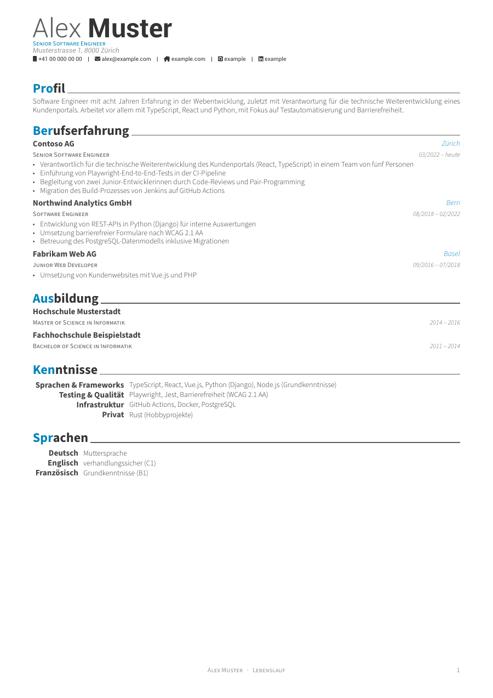
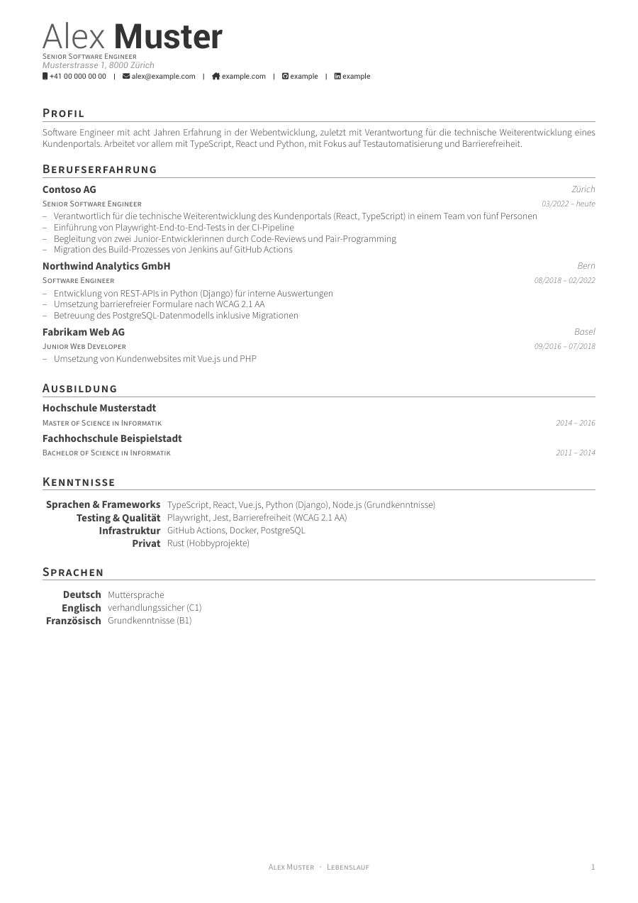
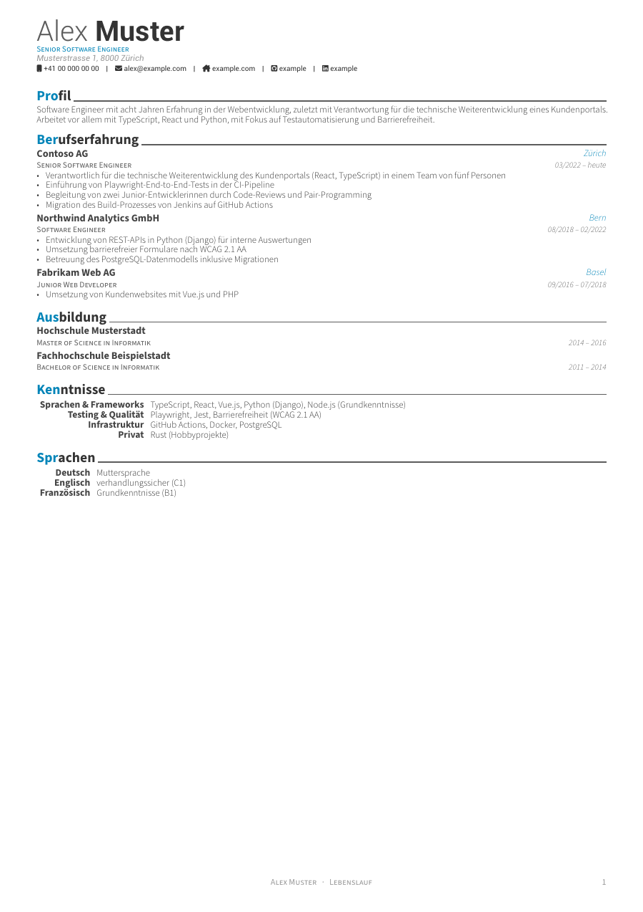

# Stile für Lebenslauf und Motivationsschreiben

Den Stil wählst du in `profile/cv.yaml`; eine Bewerbungsvariante
(`applications/<slug>/cv.yaml`) kann einzelne Werte mit eigenem `style:`
überschreiben. Der Brief übernimmt denselben Stil.

```yaml
style:
  theme: klassisch     # klassisch | schlicht | kompakt
  accent: "#0084B8"    # Hex-Farbe in Anführungszeichen; bei «schlicht» ignoriert
  photo: true          # false = kein Foto, auch wenn profile/foto.jpg existiert
```

Fehlt `style:`, gilt «klassisch» mit der Standardfarbe. Ein unbekannter Stil
oder eine ungültige Farbe bricht den Build mit einer Fehlermeldung ab.

| Stil | Wofür geeignet | Vorschau |
|---|---|---|
| `klassisch` | Standard: Tech-Firmen, Agenturen, Start-ups. Farbige Abschnittstitel (Akzentfarbe frei wählbar). |  |
| `schlicht` | Konservative Umfelder wie Banken, Versicherungen, Verwaltung, Pflege. Nur Schwarz und Grau, Abschnittstitel in Kapitälchen mit feiner Linie. |  |
| `kompakt` | Lange Lebensläufe, die sonst nicht auf zwei Seiten passen. Wie «klassisch», aber kleinere Schrift (Fliesstext 8.5 pt) und engere Abstände. |  |

Die Bilder zeigen die erste Seite des Beispiel-Lebenslaufs (Alex Muster, ohne Foto).
